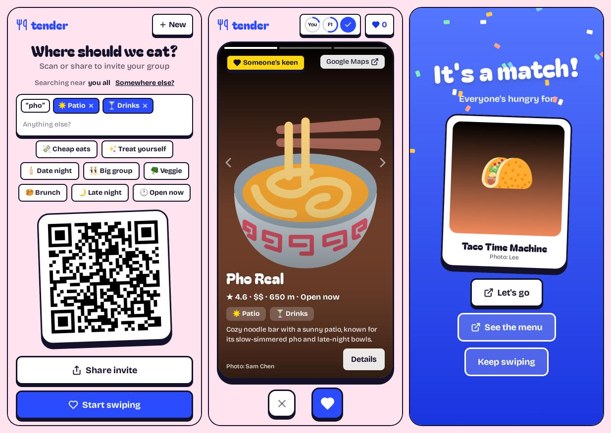

* Why

For when you and your friends can't decide where to eat. This applies
a similar approach to tinder but for finding an agreed upon place to eat.

* Try it

Tender is live at https://tender-184242101953.us-west1.run.app. Start a
session, share the link or QR code with your friends, and swipe. When
two of you like the same place, it's a match.

* WARNING

This is an active work in progress. Expect regular breaking changes

* Running this project
** Toolchain
The tools are pinned in =mise.toml=. With [[https://mise.jdx.dev][mise]] installed run
#+begin_src bash
  mise trust
  mise install
#+end_src
GHC and HLS are installed through ghcup so that HLS matches the GHC
build exactly.
** Running Tender
You will need a [[https://developers.google.com/maps/documentation/places/web-service/get-api-key][Google Places API key]] with the Places API (New)
enabled. Google needs a billing account on the project, but the monthly
free usage covers a project like this; setting a daily quota in the
Cloud console makes sure it stays free. A Maps Demo Key works too, but
Google leaves photos and reviews out of its responses, so every card
shows a placeholder.

The backend reads the key from =GOOGLE_PLACES_KEY=, or from
=pass show GOOGLE_PLACES_KEY= if that isn't set. From the top of the repository run

#+begin_src sh
  make        # backend on http://localhost:5001, app on http://localhost:1234 (BACKEND_PORT and FRONTEND_PORT in the root Makefile)
  make phone  # the same, also shared over https on your tailnet (see below)
  make test   # test both halves
#+end_src

=make= builds and starts both, and Ctrl+C stops both.

Restaurants come fresh from Google for each session. Google's terms
only allow storing place ids, so that is all the backend keeps.

The backend stores sessions and likes in =test.db=. Set
=TENDER_DB= to use a different file.

** Trying it on a phone
Browsers only give the location to https pages, so a phone can't use the
plain http dev server. With [[https://tailscale.com][Tailscale]] on both the computer and the
phone, serve it over https on your tailnet while =make= is running:
#+begin_src sh
  cd frontend
  make share     # prints the https://<machine>.<tailnet>.ts.net:8443 address
  make unshare   # stop serving it
#+end_src
Only devices on your tailnet can reach it. =SHARE_PORT= changes the port.

Tender can also be installed to the home screen ("Add to Home Screen" on
iOS, "Install app" on Android and desktop Chrome), from
=frontend/assets/manifest.webmanifest=. Its PNG icons are drawn from the
SVGs in =frontend/assets/icons=; after changing those, run =make icons= in
=frontend= (needs =rsvg-convert=).

** Running the tests
#+begin_src sh
  cd backend && make test
  cd frontend && make test
#+end_src

=make watch= in either directory rebuilds on change (needs [[https://github.com/eradman/entr][entr]]).

=make format= formats the backend with fourmolu and the frontend with
purs-tidy, at the versions CI checks with (fourmolu from =mise.toml=,
purs-tidy from =frontend/package.json=).

** Deploying to Google Cloud Run
The app runs for free within Cloud Run's free tier at low traffic, as a
single container: the backend serves the built frontend, with the API
under =/api=. It is limited to one instance, since sessions live in
that instance's in-memory database. Sessions are short lived, so losing
them when Cloud Run stops the idle instance is fine.

Once, with the Google Cloud CLI logged in and the Places project
selected:
#+begin_src sh
  gcloud auth login
  gcloud config set project <your-project>
  make deploy-setup   # services, image registry, the Places key as a secret
#+end_src

Then each time:
#+begin_src sh
  make deploy         # builds with Docker, pushes, deploys; prints the https address
#+end_src

=make deploy-secret= stores a new key from pass for the next deploy.
Google Places is the main cost, so set daily quotas and a budget alert
on the Places API before sharing the link.

* Example UI

** How it works
1. Open the app to start a session, and get everyone to scan the QR
   code or tap "Share invite".
2. Pick the vibe together (patio, cheap eats, drinks, ...).
3. Swipe right on restaurants you'd go to and left on the rest. Tap a
   card to flip through its photos, or its summary to read more.
4. Anything two people like is a match. Restaurants others liked come
   up first, and "Search further" looks wider when you run out.

** How it looks

The restaurants in the screenshots are made up; the food illustrations
are [[https://github.com/jdecked/twemoji][Twemoji]] (CC-BY 4.0).
